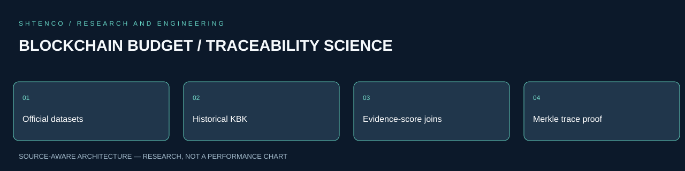
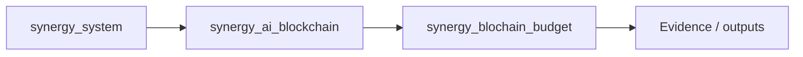

<!-- RESEARCH-V2-2026:START -->


[Научно-техническое досье V2](docs/SCIENTIFIC_DOSSIER_V2_2026.md) — алгоритмы, формализация, исследования и перспективы. Предыдущий README сохранён полностью.
<!-- RESEARCH-V2-2026:END -->

# SINERGY Blockchain Budget · V0.3 Traceability Engine

`blochain_budget` — бюджетный домен блокчейна **СИНЕРГИЯ**. Проект превращает официально опубликованные данные федерального бюджета РФ, Казначейства и публичного контура ЕИС в воспроизводимый append-only ledger с provenance, Merkle commitments и доказуемыми связями между бюджетной строкой, контрактом и платежом.

## Что добавляет V0.3

V0.1: provenance + hash-chain + Merkle roots + EVM anchor.  
V0.2: ZIP/XLS/XLSX normalizers Казначейства + KBK decomposition + reconciliation + EIS contract normalizer.  
**V0.3: строгая трассировка сущностей и versioned KBK registry.**

- отдельный registry КБК для каждого бюджетного года `2013…2026`;
- строгий запрет интерпретации КБК справочником другого года;
- несколько редакций одного года через `effective_from` + `revision_id`;
- provenance каждой импортированной строки классификатора;
- EIS contract/payment normalizer с раздельными `registry_number`, `contract_number`, ИКЗ, ИНН и датами;
- evidence-scored matching контракт  платеж;
- fail-closed сильные идентификаторы: противоречие по реестровому номеру/номеру контракта/ИКЗ запрещает auto-link;
- неоднозначный лучший кандидат получает `AMBIGUOUS`, а не произвольную связь;
- `КБК + заказчик + поставщик + период + сумма` усиливают доказательство, но сами по себе без сильного ID не превращаются в доказанную связь;
- trace object со `source_record_root` и `evidence_hash`;
- canonical `BUDGET_TRACE_COMMITMENT` record;
- Merkle inclusion proof для каждого record тем же алгоритмом сортировки, что использует snapshot;
- граф `LAW → APPROPRIATION → LIMIT → OBLIGATION → CONTRACT → SUPPLIER → PAYMENT → CASH_EXECUTION → TRACE_COMMITMENT → SINERGY_BUDGET_ROOT`.

## Версионированный KBK registry

Каталог: `config/kbk_registry.json`.

Каждый год имеет отдельную partition. Пустая partition означает **не «используй ближайший справочник», а `UNRESOLVED`**. Это специально исключает ситуацию, когда ЦСР 2015 года незаметно интерпретируется классификатором 2026 года.

Для 2026 года каталог уже содержит официальные provenance-ссылки на приказ Минфина №70н и его изменение №171н. Структурные правила отдельно ссылаются на приказ №82н и его изменения.

### Импорт официального классификатора

```bash
synergy-budget kbk-import kbk-2026.csv \
  --year 2026 \
  --revision-id 70n-base \
  --effective-from 2026-01-01 \
  --source-url https://publication.pravo.gov.ru/document/0001202507170007 \
  --source-document "Приказ Минфина России от 10.06.2025 № 70н"
```

После официальной поправки:

```bash
synergy-budget kbk-import kbk-2026-amendment.csv \
  --year 2026 \
  --revision-id 171n \
  --effective-from 2026-01-21 \
  --source-url https://publication.pravo.gov.ru/document/0001202601210003
```

Проверка конкретного кода на конкретную дату:

```bash
synergy-budget kbk-resolve 02004112010490019241 \
  --year 2026 \
  --as-of 2026-02-01
```

## Нормализация ЕИС: контракт и платеж

```bash
synergy-budget eis eis-export.zip \
  --year 2026 \
  --output data/normalized/eis-2026.jsonl
```

При наличии соответствующих полей публичного XML V0.3 сохраняет:

```text
registry_number
contract_number
ikz
customer_inn
supplier_inn
contract_date
execution_end_date
payment_id
payment_date
kbk
amount_kopecks
```

`registry_number` и `contract_number` не подменяют друг друга.

## Построение trace

Сначала объединяем нормализованные публичные записи Казначейства/ЕИС в trace-engine:

```bash
synergy-budget trace \
  --input data/normalized/treasury-2026.jsonl \
  --input data/normalized/eis-2026.jsonl \
  --registry-root data/kbk_registry/imported \
  --as-of 2026-08-21 \
  --output data/traces/traces.json \
  --records-output data/traces/trace-records.jsonl
```

Основные статусы:

- `TRACEABLE` — KBK разрешён в правильной годовой редакции, есть бюджетная строка, контракт и строго auto-linked payment;
- `TRACEABLE_TO_CONTRACT` — бюджетная строка и контракт доказательно связаны, но строгая связь с платежом ещё не установлена;
- `PARTIAL_KBK_UNRESOLVED` — код не подтверждён импортированным официальным справочником этого года;
- `REVIEW_REQUIRED` — evidence недостаточно для строгой автоматической связи или есть неоднозначный payment candidate;
- `PARTIAL_NO_BUDGET_LINE` — контракт есть, но точная бюджетная строка по `(budget_year, KBK)` не найдена.

Автоматическая связь платежа требует сильного публичного идентификатора и отсутствия противоречий. Сумма и близость периода — только дополнительные признаки.

## Merkle proof до snapshot root

Trace превращается в canonical record `BUDGET_TRACE_COMMITMENT`.

```bash
synergy-budget proofs \
  --records data/traces/trace-records.jsonl \
  --output data/proofs/record-proofs.json
```

Затем snapshot должен быть построен по **тому же набору records**:

```bash
synergy-budget snapshot \
  --records data/traces/trace-records.jsonl \
  --as-of 2026-08-21T00:00:00+00:00
```

`proofs` использует тот же `object_hash` ordering, что и `build_snapshot`, поэтому `record_merkle_root` совпадает при одинаковом наборе records. После anchoring этого root в `SynergyBudgetAnchorRegistry.sol` получается цепочка проверки:

```text
официальный raw artifact
      │ SHA-256
      ▼
canonical source record
      │
      ▼
source_record_root
      │ evidence_hash
      ▼
BUDGET_TRACE_COMMITMENT
      │ Merkle proof
      ▼
record_merkle_root
      │
      ▼
SINERGY:BUDGET anchor
```

## Trace graph

```bash
synergy-budget trace-graph \
  --traces data/traces/traces.json \
  --proof-bundle data/proofs/record-proofs.json \
  --output data/graph/trace-graph.json
```

Целевая модель:

```text
ЗАКОН
  ↓
АССИГНОВАНИЕ
  ↓
ЛБО
  ↓
ОБЯЗАТЕЛЬСТВО
  ↓
КОНТРАКТ ──→ ПОСТАВЩИК
  ↓
ПЛАТЕЖ
  ↓
КАССОВОЕ ИСПОЛНЕНИЕ (агрегатная сверка КБК)
  ↓
TRACE COMMITMENT
  ↓ Merkle proof
SINERGY:BUDGET ROOT
```

## Инварианты V0.3

1. **No cross-year KBK fallback.**
2. **No strong-ID contradiction.** Совместно опубликованные несовпадающие `registry_number`, `contract_number` или ИКЗ запрещают auto-link.
3. **No arbitrary tie-break.** Равные кандидаты не прикрепляются автоматически и помечают конкурирующие trace для review.
4. **No amount-only proof.** Совпавшая сумма сама по себе не является доказательством платежа по контракту.
5. **No false cash causality.** Кассовое исполнение КБК остаётся агрегатным evidence, пока публичный контур не даёт сильный transaction-level identifier.
6. **No float money.** Денежные величины остаются integer kopecks.
7. **Public-only.** Секретные/ограниченные данные не извлекаются и не реконструируются.
8. **Deterministic commitments.** `trace_id`, `evidence_hash`, `source_record_root` и Merkle proofs воспроизводимы из одинаковых входов.

## Тесты

```bash
pip install -e '.[dev]'
pytest -q
```

V0.3 добавляет tests для:

- year-isolated KBK registry;
- revision resolution `as_of`;
- strong contract/payment link;
- hard reject при конфликте сильного ID;
- ambiguity handling;
- trace + KBK resolution;
- record Merkle proof;
- trace graph до SINERGY root;
- EIS payment + ИКЗ;
- XLSX classifier import;
- backward compatibility V0.2 EIS/Merkle.

## Ограничение, которое проект не скрывает

Код не утверждает, что исторические справочники 2013–2022 уже полностью импортированы. Для них созданы изолированные partitions, но до получения и хэширования официального публичного classifier dataset результат остаётся `UNRESOLVED`. Это безопаснее, чем «додумывать» исторические значения из современного КБК.

Полный физический backfill крупных файлов Казначейства/ЕИС также должен выполняться на networked archive/data node с прямым доступом к официальным доменам. Репозиторий хранит pipeline, provenance rules, commitments и код верификации.

Подробная архитектура V0.3: [`docs/V0_3_TRACEABILITY.md`](docs/V0_3_TRACEABILITY.md).


<!-- SYNERGY-FEDERATION-PASSPORT:START -->
---

##  SYNERGY federation passport

**Домен:**  Blockchain traceability / budget  
**Архитектурный родитель:** [`synergy_ai_blockchain`](https://github.com/Shtenco/synergy_ai_blockchain)  
**Архитектурный корень:** [`synergy_system`](https://github.com/Shtenco/synergy_system)



Архитектурная принадлежность не заменяет доказанную интеграцию. Runtime-связь должна подтверждаться контрактами, manifests, deployment-конфигурацией или тестами.

### Федерационный принцип

Каждый репозиторий отвечает только за свой тип истины и не должен незаметно присваивать полномочия соседнего домена.

### Навигация

- [ Атлас 75 репозиториев](https://github.com/Shtenco/synergy_system/blob/main/docs/SYNERGY_REPOSITORY_ATLAS.md)
- [ Registry](https://github.com/Shtenco/synergy_system/blob/main/registry/SYNERGY_REPOSITORIES.json)
- [ Architecture root](https://github.com/Shtenco/synergy_system)

### Evidence rule

Любое сильное утверждение должно указывать на воспроизводимый тест, benchmark, ledger/evidence artifact или формально проверяемый контракт.

<!-- SYNERGY-FEDERATION-PASSPORT:END -->

---

#  Глубокий доказательный паспорт Budget Traceability

## Реальная архитектура `main`

Репозиторий уже имеет Python package `src/synergy_budget/`, CLI, официальный-source config, KBK registry, EIS/Treasury normalizers, trace graph, Merkle proofs, EVM anchor и test generations V0.1–V0.6.


## Evidence discipline

Система правильно разделяет сильные идентификаторы и вспомогательные признаки: сумма/период сами по себе не доказывают связь платежа с контрактом; conflicting strong IDs fail closed; ambiguity остаётся `REVIEW_REQUIRED`.

## Data-security boundary

Публичный контур не пытается получать или реконструировать секретные приложения бюджета. Для непубличного материала допускается только `RESTRICTED_REFERENCE`.

## Реальные проверяемые anchors

- `config/kbk_registry.json`;
- `src/synergy_budget/trace.py`;
- `src/synergy_budget/proofs.py`;
- `src/synergy_budget/merkle.py`;
- `contracts/SynergyBudgetAnchorRegistry.sol`;
- `tests/test_v02.py` … `test_v06_roi.py`.

## Следующий рубеж

signed ingest manifests → independent source publishers → large archive node → reproducible public corpus snapshot → cross-check Merkle roots on independent machine → explicit separation of observed state ROI from modeled ROI.
